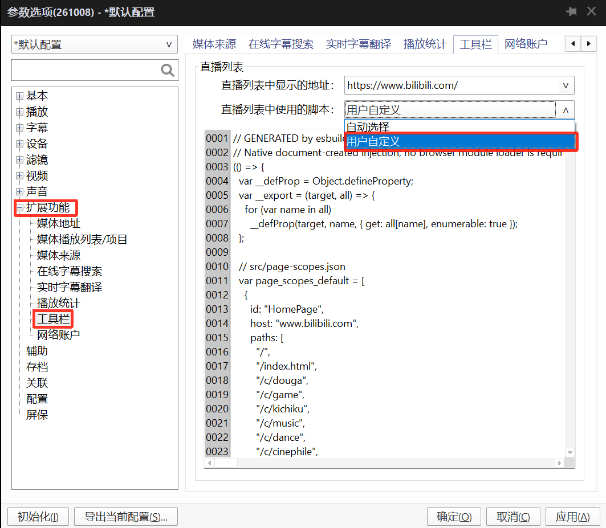

# BilibiliBroadcastListScript

为 **PotPlayer 的 Bilibili 网页广播列表**提供窄窗口布局、统一导航栏与媒体链接交接，让首页、直播、动态、搜索和个人空间等页面适合在播放器侧栏中浏览。

本项目是 [BilibiliPotPlayer](https://github.com/frostnotfall/BilibiliPotPlayer) 的配套子项目。源码按页面维护，通过 esbuild 打包成一个可直接注入的 `BroadcastListScript.js`，样式包含在文件内，无需额外加载 CSS 或 JavaScript 分块。项目原创内容使用 MIT 许可证；构建依赖及许可见 [第三方说明](THIRD_PARTY_NOTICES.md)。

本项目通过鞭策 Codex 实现。

## 功能与边界

- 适配 14 个页面模块，在窄窗口中调整卡片、列表、菜单和头像弹层。
- 为支持页面提供 32px 导航栏：后退、前进、首页、地址编辑和刷新，并跟随页面主题。
- 将视频、直播、番剧、音频和媒体列表链接发送给宿主；支持的普通页面在同一标签页打开。
- 处理 SPA 路由、动态 DOM、重复注入和完整卸载；保留原生搜索参数、修饰键、中键与下载行为。
- 提供单页调试包与公开构建检查；浏览器回归测试暂仅保留在本地。

本项目负责网页布局和链接交接。实际媒体解析、登录及播放由配套插件和 PotPlayer 宿主完成。普通浏览器没有宿主消息桥时，媒体链接保留原生打开行为。

## Potplayer BroadcastListScript 功能介绍

使用配套插件时，由宿主加载根目录的 [`BroadcastListScript.js`](BroadcastListScript.js)。该文件是正式交付产物，保留在仓库中，修改源码后需要重新生成。

`MediaPlayParse - *.as` 的 `GetBroadcastListScript()` 返回文件的完整源码，再通过 WebView2 的 [AddScriptToExecuteOnDocumentCreated](https://learn.microsoft.com/en-us/microsoft-edge/webview2/reference/win32/icorewebview2#addscripttoexecuteondocumentcreated) 注册。注册应用于后续新文档，包括子框架；已加载的当前页面需要重新导航或刷新。

媒体点击的消息格式：

```javascript
window.chrome.webview.postMessage({
  type: 'potPlayer.video-click',
  url: 'https://www.bilibili.com/video/BV…/?p=2'
});
```

宿主接收消息并将 `url` 交给播放器。发送失败时脚本保留原生行为。宿主也应独立校验消息来源、类型和 URL；网页端分类不能代替宿主验证。

维护者的本地回归使用离线 DOM、localhost 重定向与模拟 WebView 消息桥；这些测试暂未公开。本地构建检查只验证构建完整性，**不代表浏览器行为、真实 PotPlayer 或实时 Bilibili 页面已通过验收**。尚未建立最低 PotPlayer/WebView2 版本兼容矩阵；稳定版发布前应记录实际测试版本及安装位置，避免依赖未验证的固定目录。

## Potplayer 测试
设置 - 扩展功能 - 工具栏 - 直播列表 - 直播列表中使用的脚本 - 用户自定义，填入 [`BroadcastListScript.js`](BroadcastListScript.js) 内容。

截图：




## 开发环境与快速构建

构建需要 Node.js **22.13+**、pnpm **11.25.0**；推荐 Node.js 24。公开构建流程只依赖 esbuild，不需要 Edge 或 Playwright。

尚未安装 pnpm 时，可在安装 Node.js 后执行 `npm install --global pnpm@11.25.0`，然后确认 `node --version` 与 `pnpm --version`。

```powershell
# 获取仓库后，在 BilibiliBroadcastListScript 目录执行
cd BilibiliBroadcastListScript
pnpm install --frozen-lockfile --ignore-scripts
pnpm run build
pnpm run check
```

产物为根目录 `BroadcastListScript.js`，是普通 JavaScript IIFE，构建目标为 Chrome 100，CSS 通过 text loader 内嵌。构建不分块、不产生运行时模块加载依赖；Chrome 100 是语法目标，并非已验证的最低 WebView2 版本。

`pnpm-lock.yaml` 固定依赖，`package.json` 的 `packageManager` 固定 pnpm 版本。`pnpm-workspace.yaml` 只包含根包的配置，将缓存保存在本地 `.pnpm-store/`，以复制方式安装依赖；不纳入本地回归包。即使使用 `--ignore-scripts`，仍须安装 esbuild 对应平台的可选二进制依赖；不要添加 `--no-optional`。

## 项目结构

```text
BilibiliBroadcastListScript/
├─ src/
│  ├─ entry.js                  # 生产入口，静态导入并注册页面
│  ├─ pages.json                # 构建页面 ID 清单
│  ├─ page-scopes.json          # 普通页面的唯一 URL 支持范围
│  ├─ WebPage/<PageID>/         # 页面模块与页面专属 CSS
│  └─ common/
│     ├─ index.js               # 公共能力导出
│     ├─ urls.js                # URL 分类与媒体规则
│     ├─ opening.js             # 点击、消息桥、短链解析与回退
│     ├─ lifecycle.js           # 文档就绪、路由分派与销毁
│     ├─ navigation-bar.*       # 全页导航栏
│     ├─ main-site/             # 主站布局、搜索及头像交互
│     └─ live/                  # 直播布局、控件及导航
├─ .github/                     # Issue 与 PR 模板
├─ build.cjs                    # 生产、单页、watch 构建与完整性检查
├─ package.json
├─ pnpm-lock.yaml
├─ pnpm-workspace.yaml          # pnpm 配置，仅包含根包
├─ BroadcastListScript.js       # 正式交付产物，提交到仓库
├─ CHANGELOG.md                 # 按递增数字版本记录变化，不记录日期
├─ CONTRIBUTING.md              # 贡献与验证约定
├─ THIRD_PARTY_NOTICES.md        # 构建依赖与许可
└─ LICENSE                      # 项目原创内容的 MIT 许可
```

以下目录仅在本地使用，**不提交**：`tests/`、`docs/`、`.local/`、`debug/`、`verification/`、`node_modules/`、`.pnpm-store/`。现有测试与 fixture 保留在本地，旧 `docs/` 保存历史开发说明，`.local/` 保存内部记录与本地回归工具。公开构建不依赖这些未提交的目录；当前技术与页面维护说明写在 README、CONTRIBUTING 或源码旁。

页面按需导入公共能力，`src/common/` 不反向依赖 `src/WebPage/`。主站家族与直播家族分别维护交互；LiveArea 复用直播运行时，Follow 通过 `headerOnly` 模式复用直播顶栏。

## 页面范围

| 页面 ID | 支持范围概览 |
| --- | --- |
| HomePage | 主站首页、`index.html`、明确列出的频道路径 |
| LiveHome | HTTPS 直播首页、`/all` |
| LiveArea | 直播分区 `/p/eden/area-tags` |
| Feed | 动态站 `t.bilibili.com` |
| History | 主站 `/history` |
| Follow | 个人中心 `#/user-center/follow/1` 路由 |
| Space | 数字 UID 空间及声明的视频、动态、列表、收藏等路径 |
| Search | all、video、bangumi、live、article、upuser |
| Popular | 热门、每周必看、入站必刷及明确列出的排行榜 |
| Anime | 番剧、国创首页及各自 timeline/index |
| PGC | movie、tv、variety、documentary |
| Charity | 公益站首页 |
| UHD | 声明的两个超高清活动地址 |
| Podcast | 声明的两个播客活动地址 |

精确支持范围以 [`src/page-scopes.json`](src/page-scopes.json) 为准，分派和同标签页导航读取同一份配置。媒体规则在 [`src/common/urls.js`](src/common/urls.js)：数字/blanc 直播间、BV/av 视频、ep/ss/md 番剧、au/am 音频、ml 媒体列表及数字 UID 的 `/list/<uid>`。完整匹配路径，保留查询和片段；不按整个域名判定媒体。

`b23.tv` 短链通过隐藏 sandbox 框架跟随重定向，由文档创建注入回传跨域终点，校验窗口来源、随机 token 和 origin。成功缓存、失败不缓存，8 秒超时；失败时回退原短链。此流程需要在真实宿主中验证框架和弹窗限制。

## 打包与单页调试

```powershell
pnpm run build                           # 日常产物，版本为北京时间 yyyy-MM-dd HH:mm:ss
pnpm run build:release                   # 提交/发布产物，版本取自 package.json
pnpm run build:page LiveArea              # debug/LiveArea.js
pnpm run build:debug                      # 所有页面调试包
pnpm run watch                           # 生产监听重建
node build.cjs --page LiveArea --watch    # 单页监听重建
```

日常生产包、单页调试包和 watch 的每次重建都使用北京时间 `yyyy-MM-dd HH:mm:ss` 作为版本。正式构建使用 `package.json` 的数字版本，脚本头部与运行时 controller 的 `version` 保持一致。调试包只包含指定页面及其公共依赖。`verification/build-*.json` 是构建依赖图报告；它和 `debug/` 均为临时产物。新增入口或页面 ID 后需要重启 watch。

不要手工修改生成文件。修改源文件后重建生产包及受影响的调试包。单页包可直接注入已加载页面；验证文档创建时机时，在宿主中注册脚本后再导航或刷新。调试时停用宿主生产包，避免两个版本同时安装。

完整卸载：

```javascript
window.__bilibiliBroadcast?.destroy();
```

清理应覆盖监听器、计时器、RAF、观察器、短链框架和样式，并只恢复仍由自己持有的 `window.open`/`history` 包装。页面 UI 的 `destroy()` 只负责界面；公共生命周期再清理 early 阶段的实例。旧布尔防重版本升级需要刷新文档。

## 新增页面步骤

以新增 `ExamplePage` 为例，下面的域名与路径仅用于说明，应替换成实际支持范围。

1. **建立页面目录** `src/WebPage/ExamplePage/`，添加 `module.js` 和必要的 CSS。页面模块导出 `early()`、`mount()`；两个钩子返回的实例都应有幂等 `destroy()`。界面只在 DOM 就绪后安装。

   ```javascript
   import {createPageOpening} from '../../common/index.js';
   import css from './content.css';

   export const early = () => createPageOpening();

   export function mount() {
     const events = new AbortController();
     const style = document.createElement('style');
     style.textContent = css;
     document.head.append(style);
     // 用 {signal: events.signal} 注册本页面的事件。
     // 如有观察器或计时器，在 destroy 中一并清理。
     return {
       destroy() {
         events.abort();
         style.remove();
       }
     };
   }
   ```

2. **声明 URL 范围**：在 `src/page-scopes.json` 追加配置。优先使用精确 `paths`；需要正则时使用带边界的 `pathPattern`，hash 路由使用 `hashPattern`。不要为了覆盖一个页面扩大整个域名的支持范围。

   ```json
   {"id": "ExamplePage", "host": "www.bilibili.com", "paths": ["/example"]}
   ```

3. **注册构建与生产入口**：按同一顺序在 `src/pages.json` 添加 `ExamplePage`，在 `src/entry.js` 静态导入，并加入 `startDispatcher({...})`。构建检查要求 scopes 的 ID 顺序与 pages 一致。需要同模块内路由更新时，可导出无参数 `routeChanged()`；使用 `location` 读取当前地址，保持重复调用安全。
4. **复用公共能力**：按页面家族选择 `main-site/` 或 `live/`。全页导航栏由公共生命周期安装；固定控件让位时使用 `var(--broadcast-navigation-height, 0px)`，避免重复位移或复制导航栏逻辑。
5. **记录验收用例**：覆盖支持/不支持 URL、相邻路径、异步 DOM、窄屏/宽屏、点击交接、路由退出、重复注入和资源清理。在 PR 中提供操作步骤、环境与结果。若补充自动化检查，应使用原创或具有明确许可的最小合成素材，不包含登录凭据或完整网页资源。
6. **更新公开说明**：更新本 README 的页面表及必要的源码说明。`pnpm run check` 会读取页面 ID 自动检查新增页面的构建，无需接入未公开的测试文件。
7. **构建并验证**：

   ```powershell
   pnpm run build:page ExamplePage
   pnpm run build
   pnpm run check
   ```

最后在真实 PotPlayer 中检查目标页面和相邻的不支持路径，记录播放器/WebView2 版本、窗口宽度、操作步骤和结果。新增页面不能只以单页调试包通过作为生产验收依据。

## 构建检查与验证范围

```powershell
pnpm run check              # 检查当前正式产物及所有单页构建，不重写正式文件
pnpm run build              # 从源码生成正式产物
pnpm run build:debug        # 生成所有单页调试包
pnpm run check              # 确认源码和正式产物一致
```

`pnpm run check` 使用现有脚本的版本重新构建以核对源码，不改写脚本、不刷新时间版本。它检查版本一致、页面 ID/范围一致、JavaScript 语法、单文件且无外部分块、相同版本的重复构建一致性、公共模块依赖方向，以及单页包隔离。检查失败时返回非零退出码；日常产物过期时执行 `pnpm run build`，提交或发布前执行 `pnpm run build:release` 和 `pnpm run check:release`。报告输出到被忽略的 `verification/build-check.json`。

项目不使用 GitHub Actions，构建、检查和发布准备均在本地完成。测试暂未公开意味着外部贡献者目前无法复现维护者的完整行为回归。站点行为与播放器兼容性需要按操作步骤实际验收。

## 贡献与发布

贡献约定见 [CONTRIBUTING.md](CONTRIBUTING.md)，当前已知限制见本 README 的功能边界与验证范围。提交保留源码、构建工具、锁文件、当前技术说明及正式产物；本地测试、旧开发过程、内部评估和验证流水由 `.gitignore` 排除。`.gitattributes` 固定文本换行，方便跨平台构建一致性检查。

正式版本采用纯数字 `1、2、3……`，每次加一。在 `package.json` 更新版本，并在 [CHANGELOG.md](CHANGELOG.md) 顶部增加同版本的功能变化和修复；条目不记录时间。

```powershell
pnpm run build:release
pnpm run check:release
git add <本次修改的文件> BroadcastListScript.js package.json CHANGELOG.md
git commit -m "Release 1"
git push origin main
```

远程提交成功后，从该提交创建 `1` 标签及 GitHub Release（后续替换为实际数字），使用 changelog 对应条目作为发布说明，并上传本地已提交的 `BroadcastListScript.js`。提交及发布前使用正式构建入口，避免把日常时间版本作为正式产物。发布提供 SHA-256 和实际验收范围；后续公开行为回归前应核清新增素材的来源与许可。
